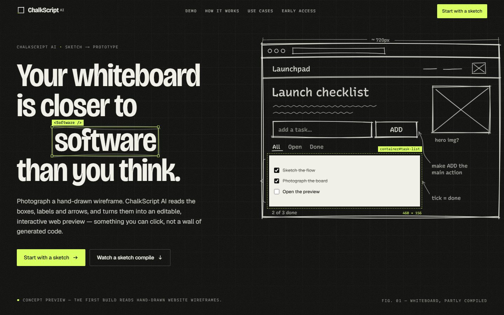
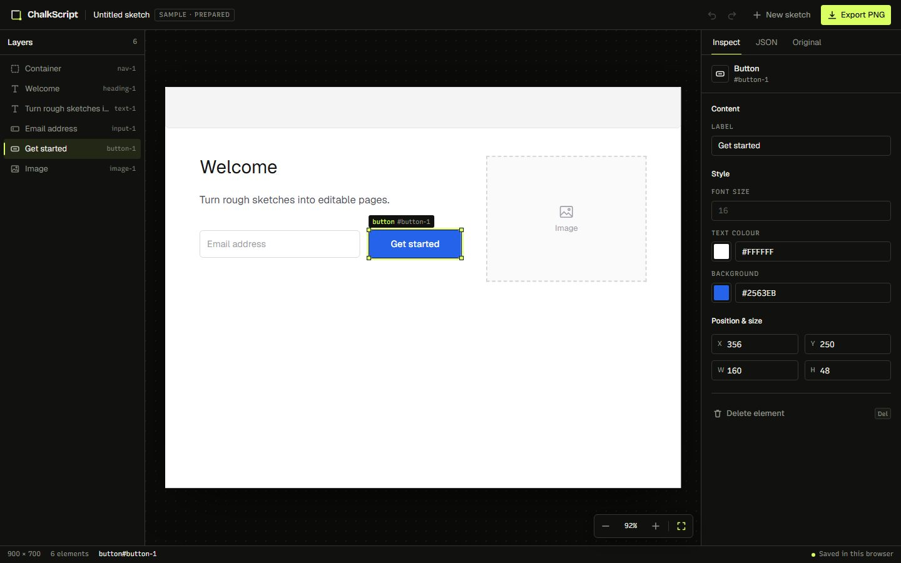
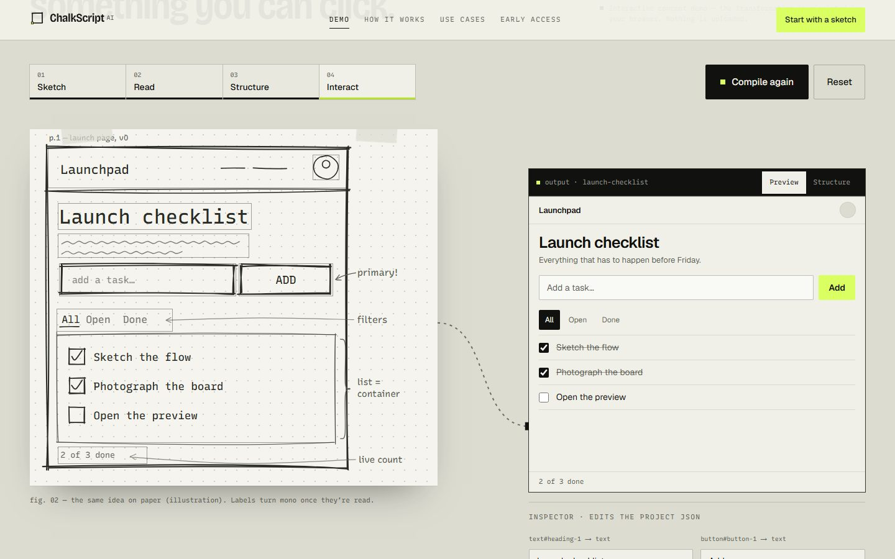

<div align="center">

# ChalkScript AI

**Turn a photo of a hand-drawn website wireframe into an editable, interactive web preview — powered by Gemma 4.**

[](LICENSE)
[](https://nextjs.org)
[](#the-model-gemma-4)
[](tsconfig.json)
[](#team)



</div>

## Contents

- [What it is](#what-it-is)
- [How it works](#how-it-works)
- [Features](#features)
- [Quick start](#quick-start)
- [The model: Gemma 4](#the-model-gemma-4)
- [The project contract](#the-project-contract)
- [Agent skill: `sketch-to-chalkscript`](#agent-skill-sketch-to-chalkscript)
- [Harness: what we changed from the original](#harness-what-we-changed-from-the-original)
- [Project structure](#project-structure)
- [Status and roadmap](#status-and-roadmap)
- [Team](#team) · [Contributing](#contributing) · [License](#license)

## What it is

Engineers, students and product teams sketch ideas on whiteboards and paper all the time — and then rebuild the same layout by hand when it's time to make it real. A photo of the board is hard to edit or share.

ChalkScript AI starts from that photo. A multimodal vision model (**Gemma 4**) reads the boxes, labels and arrows of a hand-drawn **website wireframe**. The app turns its reading into validated, structured project data and renders it as a live React page you can select, edit, inspect and export.

The structured JSON — not the photo, and not a blob of generated code — is the source of truth. That keeps the result editable.

> **Scope:** this first build reads hand-drawn **website wireframes**. Architecture diagrams, ER diagrams and user flows are on the roadmap and are shown on the landing page as planned illustrations, not working features.

## How it works

```text
 photo of a sketch
        │  PNG / JPEG / WebP, resized in the browser to ≤ 1600 px
        ▼
 POST /api/parse ─────────────────────────────── server only, key never reaches the browser
        │
        ├─ Gemma 4 (Gemini API)       semantic elements on a 0–1000 grid, JSON mode + response schema
        ├─ extract + normalize        aliases, rescale to 900×700, clamp, unique ids, paint order
        └─ validate (zod)             lib/project/schema.ts — the contract
        ▼
 { ok: true, project, notes? }
        │
        ▼
 /workspace  ── render the JSON ─ select & edit ─ undo/redo ─ JSON view ─ export PNG
```

1. **Capture.** Pick a photo or take one with the phone camera. Large photos are downscaled before upload (EXIF-aware), so phone shots work on slow connections.
2. **Interpret.** The server sends the image to Gemma 4 with a focused prompt. It asks for semantic elements (`nav`, `heading`, `text`, `button`, `input`, `image`, `card`, `container`) with boxes on the model's native 0–1000 grid.
3. **Structure.** A deterministic normalizer maps that answer onto the five contract types, scales it to a 900 × 700 canvas, and validates it with zod.
4. **Explore.** `/workspace` renders the project as real DOM. Select an element, change its text, colours, position or size, undo or redo, read the JSON, or export a PNG.

## Features

<table>
<tr>
<td width="50%" valign="top">

**Workspace (`/workspace`)**

- Upload stages: pick or camera → review → parsing → editor
- Canvas with zoom, selection handles and a layers panel
- Inspector for text, font size, colours, position and size
- Undo / redo (`Ctrl/⌘+Z`, `Shift+Ctrl/⌘+Z`), `Delete` with an undo toast
- **JSON** tab with the live project and an **Original** tab with the photo
- PNG export, plus autosave in the browser (`localStorage`)
- **Open sample** for working without an API key

</td>
<td width="50%" valign="top">



</td>
</tr>
<tr>
<td width="50%" valign="top">



</td>
<td width="50%" valign="top">

**Landing page (`/`)**

- Motion-driven page built around one idea: *the line becomes the boundary*
- Interactive compile demo (sketch → read → structure → interact) built on the real project contract and edit helpers. It is labelled as a simulation; nothing is uploaded
- Pinned scroll story, sketch-type specimens, pipeline diagram, before/after slider
- Respects `prefers-reduced-motion`; every piece of content works without the animations
- Details: [`components/landing/README.md`](components/landing/README.md)

</td>
</tr>
</table>

## Quick start

**Prerequisites:** Node.js **20.9 or newer** and npm. To parse your own sketches you also need a Gemini API key from [Google AI Studio](https://aistudio.google.com/apikey). Without a key, everything else still runs and **Open sample** loads a prepared project.

```bash
# 1. Get the code
git clone https://github.com/apsdeveloper461/HacktoberFest2k26-Team-404.git
cd HacktoberFest2k26-Team-404

# 2. Install dependencies
npm install

# 3. Configure the model (server-side only; .env.local is git-ignored)
cp .env.example .env.local
#    then set GEMINI_API_KEY=... in .env.local

# 4. Run
npm run dev
```

Open <http://localhost:3000> for the landing page and <http://localhost:3000/workspace> for the app.

**Production build:**

```bash
npm run build
npm start
```

**Call the parser directly:**

```bash
curl -F "image=@my-sketch.jpg" http://localhost:3000/api/parse
```

The response is `{ "ok": true, "project": { … }, "notes": [ … ] }`, or `{ "ok": false, "error": "…" }` with an HTTP status (see [errors](#errors-users-see)).

**Checks:**

| Command | What it does |
|---|---|
| `npm run dev` | Development server (Turbopack) |
| `npm run build` | Production build; also type-checks the project |
| `npm start` | Serve the production build |
| `npm run lint` | ESLint (flat config, `eslint-config-next`) |
| `npx tsc --noEmit` | Type-check only |

## The model: Gemma 4

ChalkScript AI uses **Gemma 4** through the **Gemini API** with Google's official [`@google/genai`](https://www.npmjs.com/package/@google/genai) SDK. Two Gemma 4 models are supported:

| Model id | Role |
|---|---|
| `gemma-4-26b-a4b-it` | **Default.** Mixture-of-experts; the faster and more reliable one in our testing (about 10–30 s per sketch) |
| `gemma-4-31b-it` | Dense model; used automatically as the fallback |

**How it's called** (`lib/ai/vision.ts`):

- **Image input:** one image plus the wireframe prompt and a system instruction, at temperature 0.2.
- **Structured output:** JSON mode plus a response schema (`MODEL_RESPONSE_JSON_SCHEMA`). If the model refuses that request shape, the call retries once with JSON mode alone.
- **Thinking:** set to *minimal* for speed. `VISION_THINKING=on` raises it (slower, sometimes more accurate).
- **Failover:** when the primary model is overloaded (429 / 500 / 503), the other Gemma 4 model is tried once. SDK retries are capped, so the failover happens in seconds rather than after a long retry loop.
- **Timeout:** 60 s per request.

### Configuration (`.env.local`)

| Variable | Required | Default | Purpose |
|---|---|---|---|
| `GEMINI_API_KEY` | yes, for Option A | — | Gemini API key. `GEMMA_API_KEY` is accepted as an alias |
| `VISION_MODEL` | no | `gemma-4-26b-a4b-it` | Primary model id |
| `VISION_FALLBACK_MODEL` | no | the other Gemma 4 model | Model tried on overload; `off` disables it |
| `VISION_THINKING` | no | off | `on` enables Gemma 4 thinking |
| `VISION_API_URL` | Option B only | — | Any OpenAI-compatible chat completions endpoint (e.g. Ollama, vLLM, OpenRouter) |
| `VISION_API_KEY` | Option B, if needed | — | Bearer token for that endpoint |

**Option B** is used only when `GEMINI_API_KEY` is empty. Set `VISION_MODEL` to whatever that server calls its vision-capable Gemma 4 model. Keys are read only by `lib/ai/*` and `app/api/*`. Never prefix them with `NEXT_PUBLIC_`, and never commit `.env.local`.

### Errors users see

| Status | When |
|---|---|
| `400` | No image, or not a PNG / JPEG / WebP of 8 MB or less |
| `422` | The model found no wireframe elements in the photo |
| `429` | The AI is busy (rate limited) |
| `502` | The API rejected the key, the image was refused, or the answer couldn't be turned into a page (after one retry) |
| `503` | No model is configured on the server. **Open sample** still works |
| `504` | The model took longer than 60 s |

## The project contract

Everything between the parser and the editor is one small, versioned JSON document, defined in [`lib/project/schema.ts`](lib/project/schema.ts) with zod:

```json
{
  "version": 1,
  "type": "wireframe",
  "canvas": { "width": 900, "height": 700 },
  "elements": [
    { "id": "heading-1", "type": "text", "text": "Welcome", "x": 60, "y": 120, "width": 300, "height": 56, "style": { "fontSize": 32, "color": "#171717" } },
    { "id": "button-1", "type": "button", "text": "Get started", "x": 356, "y": 250, "width": 160, "height": 48, "style": { "backgroundColor": "#2563eb", "color": "#ffffff" } }
  ]
}
```

- Element `type` is one of `text`, `button`, `input`, `image`, `container`.
- `style` may hold `fontSize`, `color` and `backgroundColor`.
- Edits go through the pure helpers in [`lib/project/update.ts`](lib/project/update.ts).
- The prepared demo project is [`lib/project/sample-project.json`](lib/project/sample-project.json). It is validated at import time, so a broken sample fails the build instead of the demo.

## Agent skill: `sketch-to-chalkscript`

The repo ships an [Agent Skill](skills/sketch-to-chalkscript/SKILL.md) that teaches an AI agent to do by hand what the app's pipeline does: turn a wireframe photo into a valid ChalkScript project.

```text
skills/sketch-to-chalkscript/
├── SKILL.md                     # name + description frontmatter, step-by-step workflow
├── references/contract.md       # field-by-field contract (mirrors lib/project/schema.ts)
├── assets/example-project.json  # a complete, valid worked example
└── scripts/validate.mjs         # zero-dependency validator (Node 18+)
```

- **Name:** `sketch-to-chalkscript` — lowercase with hyphens, identical to its folder name.
- **Description:** it converts a photo or screenshot of a hand-drawn website wireframe into ChalkScript project JSON and checks it with the bundled validator. Use it when someone shares a wireframe sketch and wants an editable ChalkScript project, needs `sample-project.json` rebuilt from a sample photo, or wants to debug a parse from `POST /api/parse`.
- **Install:** copy the folder into a skills directory your agent reads, e.g. `.claude/skills/` in a project or `~/.claude/skills/` for Claude Code.
- **Validate any project file:**

  ```bash
  node skills/sketch-to-chalkscript/scripts/validate.mjs lib/project/sample-project.json
  # ✓ Valid ChalkScript project: 6 element(s) (1 container, 2 text, 1 input, 1 button, 1 image), 0 warning(s).
  ```

## Harness: what we changed from the original

"Harness" here means everything around the model: the prompt, the model call, output handling, validation and the API route (`lib/ai/*`, `app/api/parse/route.ts`, `lib/upload.ts`). The original is the team's first architecture scaffold (commit [`ad326da`](https://github.com/apsdeveloper461/HacktoberFest2k26-Team-404/commit/ad326da)), whose harness was a generic OpenAI-compatible call. The app itself started from the Next.js `create-next-app` starter.

### Model harness (vs. the original scaffold)

| Area | Original | Now |
|---|---|---|
| **Provider** | Raw `fetch` to an OpenAI-compatible endpoint; `VISION_API_URL` required | Official `@google/genai` SDK on the Gemini API, running **Gemma 4** by default. OpenAI-compatible kept as Option B, with `response_format: json_object` and a plain-request fallback |
| **Model choice** | Whatever `VISION_MODEL` said | `gemma-4-26b-a4b-it` by default, with automatic one-shot failover to `gemma-4-31b-it` on 429/500/503 (`VISION_FALLBACK_MODEL`, `off` to disable) |
| **Retries** | None | SDK retries capped at one, so failover takes seconds instead of a ~40 s retry loop. One extra attempt when the answer is unusable |
| **Output control** | "Respond with JSON only" in the prompt | JSON mode + a response schema. If the request shape is refused, it retries with JSON mode alone |
| **Reasoning** | Not set | Gemma 4 thinking *minimal* by default, *high* with `VISION_THINKING=on` |
| **Prompt** | Asked for the final contract JSON in 900 × 700 pixels | System instruction + semantic types (`nav`, `heading`, `card`, …) on Gemma's native 0–1000 grid, with explicit rules (exact handwriting, unique ids, nested elements, always guess) |
| **Post-processing** | Strip code fences, `JSON.parse`, zod — any mismatch failed the whole parse | Tolerant JSON extraction (code fences, surrounding prose), then a new deterministic normalizer (`normalize.ts`): type aliases, coordinate-space detection and rescaling, clamping, unique ids, semantic → contract mapping, paint order, user-facing notes. zod is the final gate |
| **Errors** | Every failure answered `502` with a generic message | Typed `VisionError` kinds mapped to safe user messages and HTTP statuses (400, 422, 429, 502, 503, 504) |
| **Configuration** | Env read inline | `config.ts`, read at call time (a missing key can't crash the route); `GEMMA_API_KEY` alias |
| **Input** | Server-side type and 8 MB check only | Browser downscales photos to 1600 px JPEG (EXIF-aware) before upload; the server enforces PNG/JPEG/WebP ≤ 8 MB |

### App (vs. the `create-next-app` starter)

- **Kept:** Next.js 16.4 App Router, Turbopack, Tailwind CSS v4 (via `@tailwindcss/turbopack`), `cacheComponents` + `partialPrefetching`, ESLint flat config, strict TypeScript.
- **Replaced:**
  - The starter `app/page.tsx` → the ChalkScript landing page (`components/landing/`).
  - `app/layout.tsx` → brand fonts (Bricolage Grotesque, Geist, Recursive), real metadata and a theme colour.
  - `app/favicon.ico` → `app/icon.svg`, plus a generated Open Graph image.
- **Added:**
  - Routes: `/workspace` and `POST /api/parse`.
  - The contract and edit helpers (`lib/project/`) and upload rules (`lib/upload.ts`).
  - The workspace UI (`components/workspace/`, `components/upload/`, `components/app/`).
  - Brand tokens in `app/globals.css`.
  - The agent skill in `skills/`.
- **Dependencies added:** `@google/genai`, `zod`, `server-only`, `gsap`, `motion`, `html-to-image`.

## Project structure

```text
app/
  page.tsx, layout.tsx, globals.css   Landing route, root layout, brand tokens
  icon.svg, opengraph-image.tsx        Favicon and social card
  workspace/                           /workspace — upload + editor
  api/parse/route.ts                   POST /api/parse
components/
  landing/                             Landing page (self-contained, see its README)
  workspace/  upload/  app/            Workspace UI, uploader, shared app primitives
lib/
  project/schema.ts                    ★ The contract (zod + types)
  project/update.ts, storage.ts        Pure edit helpers, browser persistence
  project/sample-project.json          Prepared demo project
  ai/                                  Server-only model harness (config, prompt, vision, normalize, parse-sketch)
  api/parse.ts, upload.ts              Browser client for the route, upload rules
skills/sketch-to-chalkscript/          Agent skill (see above)
docs/images/                           Screenshots used in this README
```

Ownership, data flow and team rules are in [`ARCHITECTURE.md`](ARCHITECTURE.md). The product brief and flow are in [`CHALKSCRIPT_AI_PROJECT_PLAN.md`](CHALKSCRIPT_AI_PROJECT_PLAN.md) and [`CHALKSCRIPT_AI_FULL_FLOW.md`](CHALKSCRIPT_AI_FULL_FLOW.md).

## Status and roadmap

| | |
|---|---|
| **First build (in development)** | Hand-drawn website wireframes → `text`, `button`, `input`, `image`, `container`; inspector edits; JSON view; PNG export; sample fallback |
| **Next** | Architecture diagrams, ER / database diagrams, user flows, chat edits that change the JSON, draw.io export |

Recognition quality depends on the photo: dark marker on light paper, the whole drawing in frame, and little glare work best. The model's reading is a starting point to edit, not a pixel-perfect copy.

## Team

**Team 404 — Hacktoberfest 2026.** Built by the contributors listed on [GitHub](https://github.com/apsdeveloper461/HacktoberFest2k26-Team-404/graphs/contributors).

## Contributing

Issues and pull requests are welcome. Before opening a PR:

1. Read [`ARCHITECTURE.md`](ARCHITECTURE.md) and keep changes inside the folder you own.
2. Don't change `lib/project/schema.ts` without agreeing with both the parser and editor sides.
3. Run `npm run lint`, `npx tsc --noEmit` and `npm run build`.

## License

[MIT](LICENSE) © 2026 Mehboob Alam and the ChalkScript AI contributors.
